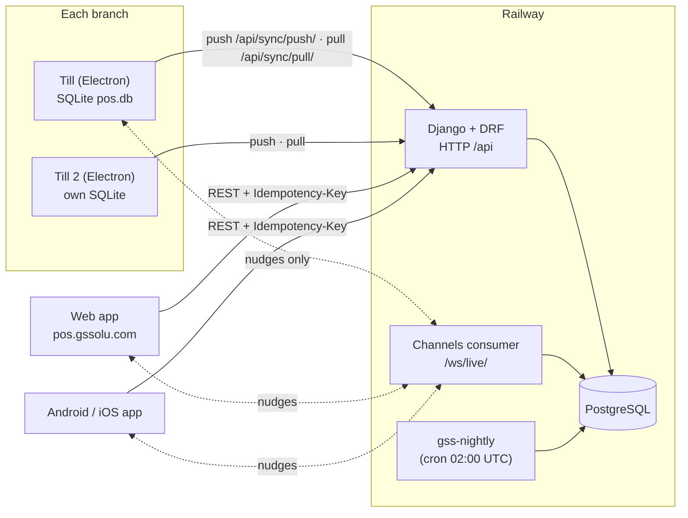
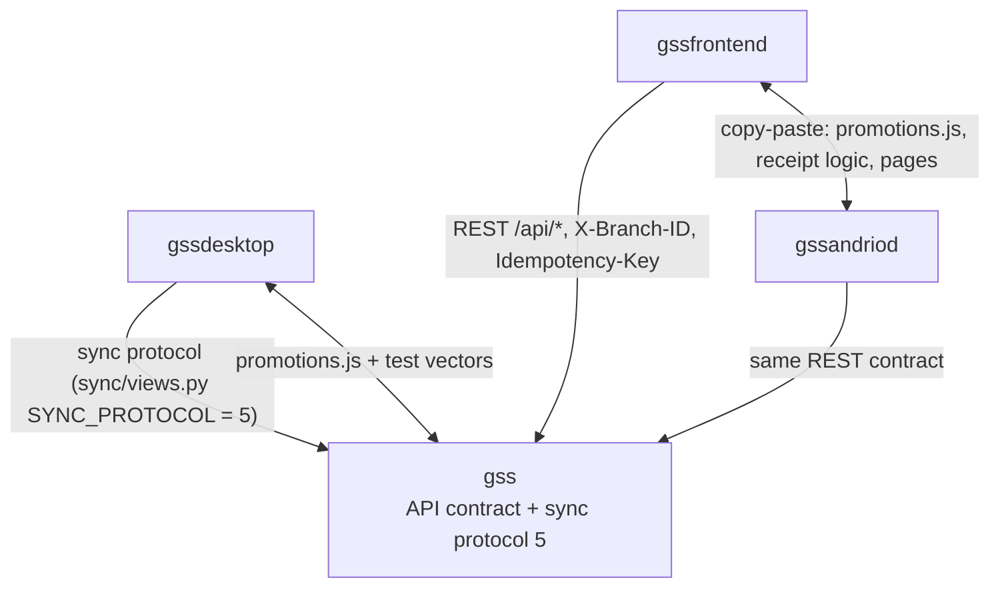

# Current architecture

What Benchline actually is today, taken from the code on `main` in all four repositories on
**21 Oct 2026**. Every claim names the file it comes from. Where something is an inference rather
than read from code, it says so.

Progress and next actions live in [`PROJECT_TRACKER.md`](../../PROJECT_TRACKER.md); the reasons
behind the design live in [`ARCHITECTURE_DECISIONS.md`](../../ARCHITECTURE_DECISIONS.md); the gaps
live in [`CODEBASE_GAP_ANALYSIS.md`](CODEBASE_GAP_ANALYSIS.md).

## 1. Repository inventory

All four repos are public under `github.com/uncleburu1-web`, default branch `main`, no uncommitted
work on 21 Oct 2026.

| Repo | Role | `main` at 21 Oct | Stack (from manifests) | Entry point | Tests | Build / deploy |
| --- | --- | --- | --- | --- | --- | --- |
| `gss` | Django backend, the cloud system of record | `d616942` (merge of PR #5, sell by weight) | Python 3.12, Django 6.0.7, DRF 3.17.1, SimpleJWT 5.5.1, Channels 4.2.0, Daphne 4.1.2, psycopg2 2.9.12, Cloudinary 1.41 (`requirements.txt`) | `benchline/asgi.py` (HTTP + WebSocket), `Procfile`: `daphne … benchline.asgi:application` | 266 Django tests (`*/tests.py`, `*/test_*.py`) | Railway service `gss`, auto-deploys `main`; `Dockerfile` runs `migrate` then Daphne. Cron service `gss-nightly` runs `manage.py nightly_maintenance` at 02:00 UTC |
| `gssdesktop` | Electron till (supermarket POS) | `f28ca85` (merge of PR #4) | Electron 44, React 19.2, Vite 8, better-sqlite3 13, electron-updater 6.3, electron-builder 25 (`package.json`) | `src/main/main.js` (main process), `src/renderer/main.jsx` (UI) | 133 `node:test` tests (`test/*.test.js`) + two-till scripts in `e2e/` | GitHub Actions `build-windows.yml` on push to `main` → NSIS installer published to GitHub Releases as a **draft** (see gap B1) |
| `gssfrontend` | Web app (owner/CEO + sellers), `pos.gssolu.com` | `bfa10e3` (merge of PR #5) | React 19.2, Vite 8, axios, react-router 7, recharts 3 | `src/main.jsx` → `src/App.jsx` | No unit tests; browser E2E scripts in `e2e/` (run by hand against a local server) | Cloudflare (`wrangler.jsonc`, static assets + SPA fallback) |
| `gssandriod` | Android/iOS app (Capacitor) | `669f36d` (merge of PR #5) | Same React app as web + Capacitor 8, ML Kit barcode, Bluetooth serial (ESC/POS), jsPDF | `src/main.jsx`; `capacitor.config.json` | Two Capacitor template tests only | `build-android.yml` (signed APK), `build-ios.yml` |

Reference repos (read only, never merged into Benchline):

| Repo | License | Use |
| --- | --- | --- |
| [SaleFlex.PyPOS](https://github.com/SaleFlex/SaleFlex.PyPOS) | **AGPL-3.0** (`LICENSE`, local clone `d6237c2`) | Concepts only. No code may be copied (ADR-002) |
| [FloCafe](https://github.com/FreeOpenSourcePOS/FloCafe) | MIT (`LICENSE`, clone `0818717`, 20 Oct 2026) | Restaurant workflow reference. See [`docs/restaurant/FLOCAFE_ANALYSIS.md`](../restaurant/FLOCAFE_ANALYSIS.md) |

## 2. The system at a glance

Two facts shape everything else:

1. **Tills never talk to each other.** Each till has its own SQLite file and meets the others only
   through the cloud. Two tills in one shop learn about each other's sales on their next pull.
2. **The web and phone apps are online-only.** They call the API directly; they have no local
   database. Only the till works offline.

## 3. Backend (`gss`)

### Apps and models

| App | Models (`<app>/models.py`) | Purpose |
| --- | --- | --- |
| `core` | `Organization`, `Shop` (a branch), `RolePermission`, `EmailOTP`, `SyncModel` (abstract), `IdempotencyRecord` | Tenancy, capabilities, idempotency |
| `staff` | `Worker`, `AttendanceRecord` | Staff and roles (`owner`, `branch_manager`, `seller`, `reception`, `technician`, `attendant`, `other`) |
| `inventory` | `InventoryItem`, `ItemVariant`, `StockBatch`, `StockMovement`, `StockTransfer`, `StockTransferLine` | Products, batches (FEFO), ledger, branch transfers, sell-by-weight flag |
| `sales` | `Sale`, `SaleItem`, `SaleAllocation`, `SalePayment`, `SaleReturn`, `SaleReturnLine` | Sales, batch allocation, payments, returns |
| `shifts` | `Shift`, `CashMovement` | Cashier sessions, cash in/out, Z-report |
| `customers`, `suppliers` | `Customer`, `Supplier` | |
| `repairs` | `RepairTicket`, `RepairPayment`, `RepairPart` | Service/repair desk |
| `liabilities`, `expenses` | `Liability`, `LiabilityPayment`, `ExpenseCategory`, `Expense` | |
| `promotions` | `Promotion` | Promotions as data (rules in JSON, one evaluator per language) |
| `devices` | `Device` | Paired tills/phones, heartbeat, pending/failed op counts |
| `subscriptions` | `Subscription`, `SubscriptionPayment` | Paystack billing |
| `sync` | `SyncOperation` | Applied till operations (the idempotency ledger) |
| `realtime` | `RealtimeEvent` | Persisted, per-shop-sequenced WebSocket events |
| `audit` | `AuditLog` | Append-only audit trail (save/delete raise `ValueError`) |
| `reports`, `branches` | none | Read-only report views; branch management views |

Quantities on stock, sale, return, transfer and repair-part rows are `Decimal(12,3)` since
`inventory 0010` / `sales 0012` / `repairs 0003` (applied in production 21 Oct 2026 07:06 Lagos).
Money is `Decimal(12,2)`.

### Request path

`benchline/asgi.py` routes HTTP to Django and WebSockets through `realtime.middleware.JWTAuthMiddleware`
to `realtime/routing.py`. HTTP auth is SimpleJWT bearer tokens (8 h access token,
`benchline/settings.py`). Login is `core.auth_serializers.DeviceAwareTokenObtainPairSerializer`,
which pairs a device to a branch on first login.

`subscriptions/gate.py` `SubscriptionGateMiddleware` answers **402** `subscription_expired` to every
API call once the organization's period ends, except sign-in, status and payment endpoints. There
is no grace period.

### Tenancy and authorization

- `Organization` (owned by the CEO user) → many `Shop` rows (branches). Every business row inherits
  `core.models.SyncModel`, which carries a `shop` foreign key.
- `core/mixins.py` `ShopScopedMixin.get_queryset()` filters every list/retrieve to
  `core.utils.get_shops_for_user()`; writes resolve exactly one branch with `get_shop_for_user()`.
  A CEO may pick a branch with the `X-Branch-ID` header; the server checks it belongs to their
  organization. A branch user is pinned to their branch whatever the header says.
- Roles: `core/permissions.py` `is_owner` (owner or branch manager) and `is_ceo`. Everything else
  goes through `core/capabilities.py` `has_capability()`, which the owner toggles per role in the
  Control Center (`RolePermission` rows).
- Sync resolves the branch from the **device** (`X-Device-ID` → `Device.shop`), checked with
  `core.utils.user_may_use_branch_device()`, not from the user (fixed in stage 1).

### Idempotency

- Web/phone creates: `Idempotency-Key` header, one `IdempotencyRecord` per (user, key)
  (`core/idempotency.py`). Same key + different body → rejected.
- Till ops: each outbox row's UUID becomes `SyncOperation.id`; inserting it inside the apply
  transaction is the lock. Same id + same `payload_hash` → `already_applied`; same id + different
  hash → `rejected` (`sync/views.py` `payload_hash`, `SyncPushView`).

## 4. Till (`gssdesktop`)

- Main process: `src/main/main.js` opens `pos.db` (`src/main/db.js` `openDb`, WAL mode), registers
  IPC handlers (`pos:*`, `printers:*`, `print:receipt`), starts the sync engine (`src/main/sync.js`),
  heartbeat (`heartbeat.js`) and updater (`updater.js`).
- Tables (`src/main/schema.sql` + `migrate()` in `db.js`): `products`, `categories`,
  `stock_batches`, `stock_movements`, `stock_docs`, `sales`, `sale_items`, `sale_allocations`,
  `sale_payments`, `sale_returns`, `sale_return_lines`, `shifts`, `cash_movements`, `customers`,
  `promotions`, `carts`, `app_settings`, `sync_queue`.
- Screens (`src/renderer/App.jsx`): Sell, Products, Customers, History, Shift, Day report, Printer.
  Suppliers, repairs, expenses, liabilities, transfers, promotions setup and reports are web/phone
  only.
- Auth: online login caches a salted scrypt hash for offline sign-in (`auth.js`); tokens are
  encrypted with Electron `safeStorage` (`secrets.js`, stage 6).
- Receipt numbers are `<till code>-<counter>` (`db.js` `createSale`), unique by construction per
  till; `invoice_number` is a per-till display counter only.

### Local schema vs cloud schema

| Concept | Till (SQLite) | Cloud (Postgres) | Note |
| --- | --- | --- | --- |
| Product | `products` (+ `sold_by_weight`) | `InventoryItem` (+ `ItemVariant`) | Variants are cloud only; the till sells the base item |
| Stock | `stock_batches` + `stock_movements` | `StockBatch` + `StockMovement` | Same ledger idea on both sides; a till applies cloud movements as deltas |
| Sale | `sales`, `sale_items`, `sale_allocations`, `sale_payments` | same four models | Uploaded as one `sale_doc` op |
| Return | `sale_returns`, `sale_return_lines` | `SaleReturn`, `SaleReturnLine` | |
| Shift | `shifts`, `cash_movements` | `Shift`, `CashMovement` | Z-report frozen at close |
| Damage / count | `stock_docs` | `StockMovement` (DAMAGE / ADJUSTMENT) | |
| Outbox | `sync_queue` | `SyncOperation` (the receiving side) | |
| Audit | audit rows go up as `audit_event` ops | `AuditLog` | |

## 5. Tracing one sale end to end

Verified in code, and exercised by `test/stage2.test.js` (till) and `sync/test_stage2.py` (server):

1. **Cashier taps Charge.** `PosScreen.jsx` calls IPC `pos:createSale`.
2. **One local transaction.** `db.js` `createSale` is a `db.transaction(...)`: it writes the sale,
   its lines, FEFO batch allocations and stock decrement, `stock_movements`, `sale_payments`, and one
   `sync_queue` row of type `sale_doc` via `enqueueSync`. If any step throws, nothing is written and
   the UI shows the error, so the till never reports a sale it did not store.
3. **Push.** `sync.js` `pushBatch` sends pending rows to `POST /api/sync/push/` with the bearer token
   and `X-Device-ID`. No network → rows stay `pending`; the till keeps selling.
4. **Server applies.** `sync/views.py` `SyncPushView.post` computes `payload_hash`, then per op runs
   `transaction.atomic()`: insert `SyncOperation` (the duplicate lock), apply via `_HANDLERS['sale_doc']`
   (header, lines, allocations, payments, movements, audit) in that same transaction.
5. **Response.** Each op gets `applied`, `already_applied` or `rejected` with a message.
6. **Till records the outcome.** `applied`/`already_applied` → row marked synced; `rejected` →
   `failed` with the server's message, visible in the sidebar, retried only when someone presses
   Retry (`retryFailedSync`, audited); 5xx/429 → counted retry with backoff 30 s → 5 min, released
   as soon as a call succeeds (stage 1b); 402 → "paused", nothing counted.
7. **Others hear about it.** After commit, `realtime.events.broadcast` writes a `RealtimeEvent` and
   nudges `/ws/live/`. Other tills and the web pull the change over HTTP.

What happens when things go wrong is tabulated in section "Failure testing" of the
[architecture analysis doc](https://claude.ai/artifact/4fdJDw29CmJ5VcVMZGiYfX) and re-checked in
[`CODEBASE_GAP_ANALYSIS.md`](CODEBASE_GAP_ANALYSIS.md#3-failure-scenarios).

## 6. WebSockets (`realtime`)

- One consumer, `realtime/consumers.py` `ShopEventsConsumer`, at `/ws/live/`. The JWT is checked by
  `realtime/middleware.py`; unauthenticated sockets close with code 4001.
- On connect the socket joins one group per branch the user may see (`shop_<id>`), so a seller only
  ever hears their own branch and a CEO hears their organization's branches.
- `realtime/events.py` `broadcast()` runs on `transaction.on_commit`: it takes the next per-shop
  sequence number (`Shop.last_event_sequence`, row-locked), stores a `RealtimeEvent`, then sends.
  Clients compare sequences on `hello` to learn they missed something and then re-fetch over HTTP.
- Events carry only a type, ids and small hints. **Data never travels over the socket**; the
  database is the record and HTTP is how clients read it.
- Channel layer: `InMemoryChannelLayer` unless `REDIS_URL` is set (`benchline/settings.py`). That
  works only while the backend runs as **one process**, which is how Railway runs it today.
- The socket also carries presence: the till pings, and `Device.last_ws_seen_at` feeds the
  ONLINE / STALE / OFFLINE status the owner sees (stage 1b).

## 7. Clients and shared code

- Web and phone are the **same React codebase in two repos**. They have drifted (for example
  `Sales.jsx` differs by 132 lines, `Reports.jsx` by 319), and some pages exist in only one
  (`Expenses.jsx` and `Signup.jsx` are web only; `PrinterSetup.jsx` is phone only).
- The promotion evaluator `promotions.js` is byte-identical in the web, phone and till repos, and
  matches `gss/promotions/engine.py` through 14 shared test vectors (`promotions/test_vectors.json`).

## 8. Cross-repository dependencies

Release order is therefore always: **`gss` first**, then the clients. A client that sends a field
the server does not know yet (for example a decimal quantity) is refused until the server is updated.

## 9. Build and deployment

| Piece | How it ships | Evidence |
| --- | --- | --- |
| Backend | Push to `main` → Railway builds the Dockerfile, runs `migrate`, starts Daphne | Railway deployment `a995b203` (21 Oct 2026) applied the three sell-by-weight migrations |
| Nightly job | Railway service `gss-nightly`, cron `0 2 * * *`, `python manage.py nightly_maintenance` (retention + ledger drift check) | 21 Oct run: "Stock ledger matches every batch" |
| Till | Actions builds `v1.0.<run>` and creates a GitHub Release **as a draft**; the till's `electron-updater` asks the user before downloading | Releases v1.0.17 to v1.0.22 are all `draft=true` (checked 21 Oct) |
| Web | Cloudflare static deploy | `wrangler.jsonc` |
| Android / iOS | Actions build a signed APK and an iOS build on push to `main` | `build-android.yml`, `build-ios.yml` runs on `669f36d` succeeded |
| Database backups | Manual `pg_dump` from the owner's PC (the Railway plan has no automatic backups) | Stated by the owner |
