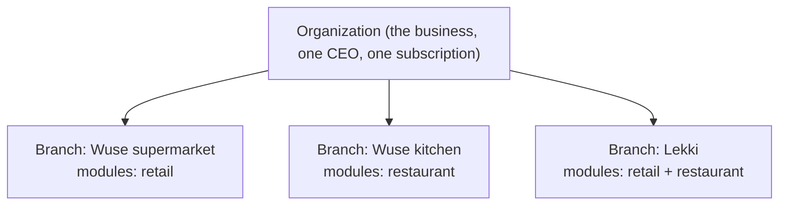
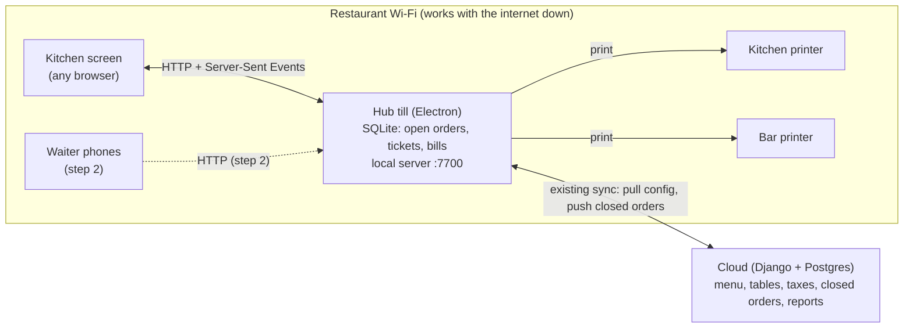

# Target architecture

Where Benchline is heading, after the owner's decisions of **21 Oct 2026**. Today's system is in
[`CURRENT_ARCHITECTURE.md`](CURRENT_ARCHITECTURE.md). Restaurant details are in
[`docs/restaurant/`](../restaurant/). Status: **design, awaiting review. Nothing here is built.**

## 1. One business, branches of different kinds

**Decision 4:** one business can run supermarket branches, restaurant branches, or both. Each
branch is configured on its own.

### How a branch says what it is

Today `Organization.business_type` (gadgets / clothing / pharmacy / general) is set once per
business and switches the Service module on or off for **every** branch. That cannot express "this
branch is a restaurant".

**Proposal:** a small table of enabled modules per branch.

| Model | Fields | Rules |
| --- | --- | --- |
| `BranchModule` (new, `core`) | `shop` (FK), `module` (`retail`, `restaurant`, `service`), `enabled`, `enabled_at`, `enabled_by` | Unique on (`shop`, `module`). Only the CEO or an owner of that branch may change it; every change writes an `AuditLog` row |

- `Organization.business_type` stays, but only as the **retail catalogue flavour** (it drives the
  category list). It no longer decides modules.
- Migration (data only, nothing removed): every existing branch gets `retail`, plus `service` if
  its organization has Service today. Nothing changes for current shops.
- A branch may have more than one module (a supermarket with a café counter).

| Option considered | Why not chosen |
| --- | --- |
| A single `Shop.kind` field (`retail` or `restaurant`) | Cannot express a branch that does both |
| Boolean columns on `Shop` (`has_restaurant`, …) | Every new module is a migration; no record of who switched it on |
| JSON list on `Shop` | Cannot be indexed or constrained; no audit per change |

### How the rule is enforced

- Server: a permission `RequiresModule('restaurant')` on every restaurant endpoint and every
  restaurant sync handler. A request for a branch without the module gets **403**
  `module_disabled`. The branch is resolved exactly as today (`get_shop_for_user`, device → branch
  for tills), so a user cannot reach another business's restaurant by changing an id, a header or a
  socket group.
- Clients: `/api/me/` returns the modules of each branch the user can see. The web and phone apps
  show restaurant pages only for a branch that has the module; the till shows the restaurant
  screens instead of the supermarket Sell screen when its paired branch is a restaurant.
- Per-branch settings already live on `Shop` (currency, time zone, receipt, tax default). The
  restaurant adds its own per-branch configuration (menu, tables, stations, taxes, service charge;
  see [`DOMAIN_MODEL.md`](../restaurant/DOMAIN_MODEL.md)). Staff, devices and stock are already
  per branch.

### Packages: what a business may switch on (decision 3)

A branch costs the same whatever it is: the base subscription and the per-branch price do not
change for a restaurant. What differs is the **package** the business subscribes to, which decides
which features it may switch on.

| Feature code | Covers |
| --- | --- |
| `retail` | Today's supermarket features (every existing business keeps this) |
| `service` | Repairs / service desk (as today) |
| `restaurant.tables` | Floor plan, dine-in orders |
| `restaurant.kitchen` | Kitchen stations, tickets, kitchen ticket printing, kitchen screens |
| `restaurant.waiters` | Waiter phones (step 2) |
| `restaurant.recipes` | Recipe costing and ingredient stock (later) |

- **Model:** a `Package` (code, name, list of feature codes, optional add-on price) and
  `Subscription.package`. Packages are data, so they can be added or re-priced without code. Every
  existing subscription gets the "Retail" package (plus `service` where on today): nothing changes.
- **Rule:** a branch module can be switched on, and restaurant configuration saved, only if the
  package includes the features it needs (403 `not_in_package`). The hub learns its features from
  the pull.
- **Never mid-service:** consistent with the existing rule that billing only controls cloud services,
  a package change or an expired subscription never stops a hub that is already running a
  restaurant; it stops new set-up and cloud sync, exactly as for supermarket tills.
- **Trial:** proposed to include every package, so a restaurant can try the full system.
- **Open (pricing only):** the add-on price of the restaurant package(s), if any.

## 2. The restaurant runs on a hub till on the shop's Wi-Fi

**Decision 3:** a local restaurant server on the shop's Wi-Fi, with kitchen printing as an extra
fallback. The owner asked to check whether the existing desktop can host it simply before building
anything heavier.

### What the existing till can already do (audited 21 Oct 2026)

| Need | Existing till | Verdict |
| --- | --- | --- |
| Keep orders safe through a crash | SQLite in WAL mode, one transaction per write (`src/main/db.js`) | Reuse |
| Upload to the cloud with no duplicates | Outbox + idempotent sync protocol (`src/main/sync.js`, `sync/views.py`) | Reuse; add order documents |
| Print to several printers | Silent printing to a named Windows printer (`main.js` `print:receipt`) | Reuse: one hidden print page per kitchen ticket, each to its station's printer |
| Serve a kitchen screen on the Wi-Fi | Electron's Node process has a built-in HTTP server module; nothing listens today | **Add** a small local server inside the till, no new runtime |
| Push live updates to the kitchen screen | No WebSocket server in Node's standard library | Use **Server-Sent Events** (plain HTTP, built into every browser, automatic reconnect with `Last-Event-ID`). No new library |
| Find the hub on the network | Nothing | Show the hub's address and a QR code on the hub screen; recommend a fixed IP (DHCP reservation) on the router |

**Conclusion:** the simplest reliable shape *is* the existing till acting as the hub. No separate
server program, no extra database, no Redis, no Docker on site.

| Alternative | Why rejected |
| --- | --- |
| Share the till's SQLite file over a Windows network share | SQLite over network shares corrupts under concurrent writers |
| Run Django + Postgres on a PC in the restaurant | A second server to install, update, back up and secure in every restaurant |
| Peer-to-peer sync between tills | Merging two waiters' offline edits to one order is hard to get right |

### Who is the record for what

| Data | System of record | Why |
| --- | --- | --- |
| Menu, modifiers, tables, stations, taxes, service charge, staff, branch modules | **Cloud** (edited on the web; pulled by the hub) | One place to configure; owner can change it from anywhere |
| An **open** order, its kitchen tickets, its bill and payments in progress | **Hub till** | Must work with the internet down; one copy means two waiters never disagree |
| A **closed** (or cancelled) order | **Cloud**, once uploaded | Reports, audit, CEO view; the hub keeps a local copy |
| "Sold out" switches during service | Hub (synced up for the record) | Needed instantly in the building |

Every record keeps the UUID the hub gave it, in the cloud too, so there are no temporary ids to
swap.

### Deployment and maintenance burden (the owner asked for this estimate)

Per restaurant, on top of a normal till install:

| Item | Effort | Note |
| --- | --- | --- |
| Allow the hub through Windows Firewall on its port | Once, ~5 min | The installer can add the rule; otherwise Windows asks the first time |
| Fixed address for the hub (DHCP reservation on the router) | Once, ~10 min | Otherwise kitchen screens lose the hub when its address changes |
| Install each kitchen printer in Windows and pick it per station | Once per printer | Same as receipt printers today |
| A browser device per kitchen screen (tablet or old PC), paired once with a code | Once per screen | Optional: printer-only kitchens skip it |
| A UPS on the hub PC and the router | Hardware | Power cuts are the most likely way the restaurant stops; the hub must not lose power mid-service |

Ongoing:

- **Updates:** the kitchen screen page is served by the hub, so it is always the hub's version; no
  separate app to update. Hub and cloud must stay protocol-compatible (same rule as tills today).
- **Support:** a new class of problem, "the kitchen screen can't see the hub" (Wi-Fi, firewall,
  address). A built-in "network check" page on the hub is planned to make it diagnosable by phone.
- **Single point of failure:** if the hub PC is off, the restaurant cannot take orders on the
  system. Mitigations: UPS; the hub restarts into exactly the state it left (SQLite); the hub
  mirrors open orders to the cloud whenever online, so a replacement hub can recover them.

Rough engineering size (one developer, focused): local server + pairing + SSE **M**, kitchen
screen page **M**, multi-printer kitchen tickets **S–M**, restaurant order engine on the till **L**,
cloud configuration + ingestion + reports **M–L**.

### Steps

1. **Hub + kitchen printers + kitchen screens.** Orders are taken on the hub till itself.
2. **Waiter phones** talking to the hub over Wi-Fi. Extra work: Android blocks plain-HTTP calls to
   local addresses by default, so the phone app needs a network security exception for private
   addresses, or the hub needs a certificate. To be designed before step 2.

## 3. Shared code between apps

**Decision 2:** consistent behaviour, not identical implementations.

- The **Django API is the contract.** Every rule that protects money or stock is enforced on the
  server, whichever app sends the request (already true for sales, payments, stock, returns).
- Contracts are documented per endpoint ([`API_SPECIFICATION.md`](../restaurant/API_SPECIFICATION.md)).
- **Pure business calculations** that must run offline (promotions today; restaurant tax and
  service charge next) are written once in JavaScript, copied byte-for-byte into each app that needs
  them, and kept identical to the Python version by shared test vectors. A CI check that the copies
  are identical is proposed.
- Web and Android stay separate apps. No forced merge of their UI code.
