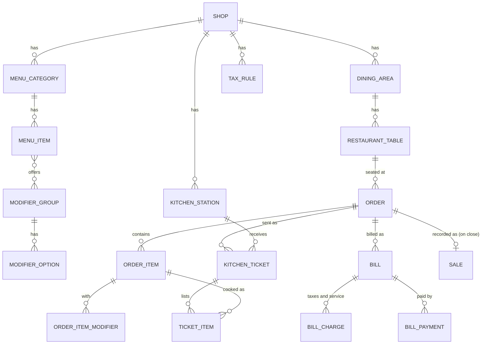

# Restaurant domain model

The data the restaurant needs, where it lives, and how it relates to what Benchline already has.
Rules and workflows: [`REQUIREMENTS.md`](REQUIREMENTS.md). States: [`ORDER_LIFECYCLE.md`](ORDER_LIFECYCLE.md).
Status: **design, awaiting review.**

## 1. Principles

- A new Django app `restaurant` (ADR-014). Every model inherits `core.models.SyncModel`, so every
  row has a `shop` (branch), a UUID primary key, `created_at`/`updated_at` and `is_deleted`.
  That is the tenant boundary: every query is filtered by the branches the user may see.
- **Reuse, don't duplicate:** `Organization`/`Shop` (tenancy), `Worker` (staff), `Device` (hub and
  kitchen screens), `Shift`/`CashMovement` (cashier sessions), `AuditLog`, `Customer`.
- **Not reused:** `InventoryItem` is not a menu item (a dish has modifiers, a station and
  availability, not batches), and `Sale` is not an order (a sale is final when created; an order
  changes for an hour). When an order closes, the cloud **also** writes a `Sale` with
  `source='restaurant'` so existing reports, payment summaries and Z-reports include it.
- **An order item and a kitchen ticket item are different things** (ADR-015). The order item is
  what the customer pays for; the ticket item is work a station must do.
- Money `Decimal(12,2)`; quantities `Decimal(12,3)` (same as retail); rates `Decimal(7,4)` in
  percent (7.5000 means 7.5%).

## 2. Configuration (edited in the cloud, pulled by the hub)

| Model | Purpose | Key fields | Constraints / indexes |
| --- | --- | --- | --- |
| `RestaurantSettings` | Branch-level options | `shop` (one-to-one), `hub_device` (the one `Device` allowed to be this branch's hub), `service_charge_rate`, `service_charge_types` (e.g. `["dine_in"]`), `service_charge_taxable`, `require_served_before_payment` (R10), `order_number_prefix` | One per branch. Only one hub per branch, so two tills can never both run the same restaurant |
| `DiningArea` | "Hall", "Terrace" | `name`, `sort` | Unique (`shop`, `name`) |
| `RestaurantTable` | A table | `area`, `label` ("T12"), `seats`, `is_active` | Unique (`shop`, `label`). Occupancy is **not** stored here: it is derived from open orders (section 3), so it can never disagree with them |
| `KitchenStation` | Where food is made | `name`, `prints` (bool), `printer_name` (Windows printer on the hub), `shows_on_screen` (bool), `is_active`, `sort` | Unique (`shop`, `name`). At least one of `prints` / `shows_on_screen` |
| `MenuCategory` | "Rice dishes", "Drinks" | `name`, `station` (default route), `sort`, `is_active` | Unique (`shop`, `name`) |
| `MenuItem` | A dish or drink | `category`, `name`, `price`, `station` (overrides the category's), `tax_class` (e.g. `food`, `drink`), `is_available` (sold-out switch), `image_url`, `sort`, `is_active` | Unique (`shop`, `name`). `price ≥ 0`. Optional `inventory_item` link for stocked drinks: **not in the first release** |
| `ModifierGroup` | "Size", "Extras" | `name`, `min_select`, `max_select` | `0 ≤ min ≤ max`. A required single choice ("Size") is `min=max=1`; this replaces separate "variants" |
| `ModifierOption` | "Large", "Extra chicken" | `group`, `name`, `price_delta`, `is_available`, `sort` | `price_delta` may be 0 |
| `MenuItemModifierGroup` | Which groups an item offers | `menu_item`, `group`, `sort` | Unique pair |
| `TaxRule` | VAT, Lagos consumption tax, … | `name`, `rate`, `inclusive` (bool), `tax_classes` (which `tax_class` values it covers; empty = all), `applies_to_service_charge`, `valid_from`, `valid_to`, `is_active` | Index (`shop`, `valid_from`). A bill uses the rules valid on its business date |

Who may change configuration: owners / branch managers of that branch and the CEO, except the
sold-out switch (`is_available`), which the hub can flip during service (`mark_sold_out` capability).
Every change is audited (`restaurant.config.changed`).

## 3. Operations (created on the hub; uploaded when finished)

| Model | Purpose | Key fields | Constraints / indexes |
| --- | --- | --- | --- |
| `Order` | One table's or customer's order | `number` ("K-0042", per hub per business day), `service_type` (`dine_in`, `takeaway`, `counter`), `table` (null unless dine-in), `guests`, `opened_by` / `waiter` (Worker), `status` (`open`, `closed`, `cancelled`), `opened_at`, `closed_at`, `business_date`, `device` (hub), `cancel_reason`, `notes` | Index (`shop`, `status`), (`shop`, `business_date`). **One open dine-in order per table** (unique index on `table` where `status='open'`). Payment and kitchen status are **derived**, never stored, so they cannot drift |
| `OrderItem` | A line the customer pays for | `order`, `menu_item`, `name` and `unit_price` (snapshots), `quantity`, `notes` ("no pepper"), `state` (`pending`, `sent`, `served`, `voided`), `sent_at`, `voided_quantity`, `void_reason`, `waste` (bool), `voided_by` | `quantity > 0`. Price snapshot means a later menu price change never alters an open or closed order |
| `OrderItemModifier` | A chosen option | `order_item`, `option`, `name`, `price_delta` (snapshots) | |
| `KitchenTicket` | One send to one station | `order`, `station`, `number` (per station per day), `kind` (`new`, `void`), `sent_by`, `sent_at`, `print_count` | Index (`shop`, `station`, `sent_at`) |
| `KitchenTicketItem` | Work for that station | `ticket`, `order_item`, `quantity`, `state` (`queued`, `preparing`, `ready`, `served`, `voided`), `started_at`, `ready_at`, `served_at`, `version` (bumped on every change, for compare-and-set) | Index (`ticket`, `state`) |
| `Bill` | What the customer owes | `order`, `number`, `status` (`open`, `settled`, `void`), `subtotal`, `discount`, `discount_reason`, `discount_by`, `total`, `printed_at`, `print_count` | First release: one bill per order (model allows more for split bills later) |
| `BillCharge` | Each service-charge and tax line, frozen | `bill`, `kind` (`service_charge`, `tax`), `tax_rule` (nullable), `name`, `rate`, `inclusive`, `base`, `amount` | The snapshot that makes old bills immune to rate changes |
| `BillPayment` | Money received | `bill`, `method` (`cash`, `transfer`, `card`, `mobile`), `amount`, `tendered`, `change`, `tip`, `reference`, `shift_ref`, `received_by`, `received_at` | Append-only (no update, no delete; a mistake is reversed by a negative line with a reason, audited). `amount > 0` on normal lines |

Derived values (computed, never stored):

| Value | Rule |
| --- | --- |
| Order payment status | Σ payments vs bill total: `unpaid`, `partly_paid`, `paid` |
| Order kitchen status | From its ticket items: `not_sent`, `in_kitchen`, `ready`, `served` |
| Table status | `free` (no open order), `occupied` (open order), `billing` (open order with a printed bill) |

## 4. Where each model lives

| Model | Hub (SQLite) | Cloud (Postgres) | Direction |
| --- | --- | --- | --- |
| Configuration (section 2) | Read-only copy (except sold-out) | Record | Cloud → hub (pull) |
| Order and everything under it | Record while open | Copy of every closed/cancelled order; mirror of open ones | Hub → cloud (push) |
| `Sale` written on close | — | Record | Created by the cloud on ingest |
| Hub event log (`hub_events`) | Record | — | For kitchen screens; pruned after 7 days |

## 5. Audit

Uses the existing `AuditLog`. New actions: `restaurant.item_voided`, `restaurant.order_cancelled`,
`restaurant.discount`, `restaurant.table_moved`, `restaurant.ticket_reprinted`,
`restaurant.payment_override` (R10), `restaurant.sold_out`, `restaurant.config.changed`. Hub-side
entries travel up as `audit_event` ops, exactly as till entries do today.

## 6. Staff and permissions

New roles in `Worker.ROLE_CHOICES`: `waiter`, `kitchen`. A cashier is today's `seller`. New
capabilities (owner switches them per role in the Control Center): `take_orders`, `send_to_kitchen`,
`void_sent_item`, `cancel_order`, `apply_discount`, `move_table`, `take_payment`, `reprint_ticket`,
`mark_sold_out`, `override_served_rule`. Owners and branch managers keep everything, as today.
