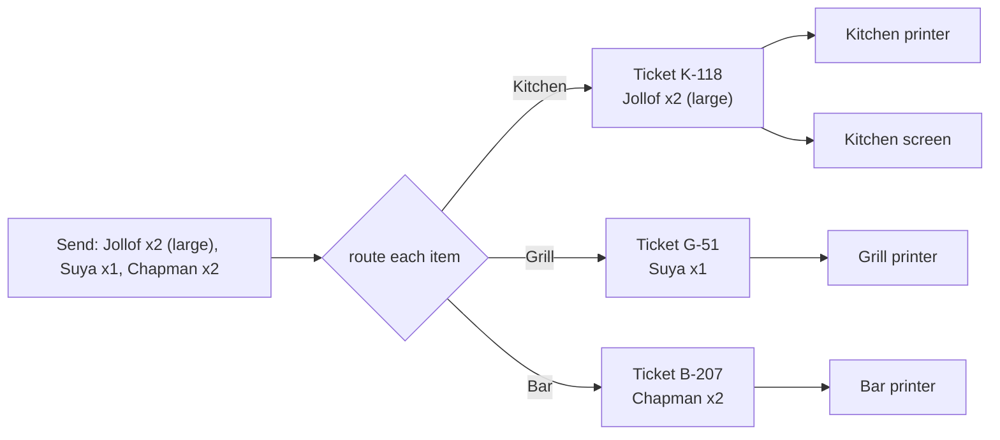

# Kitchen workflow

How sent items reach the people cooking them: routing, printed tickets, kitchen screens, voids and
reprints. States and permissions: [`ORDER_LIFECYCLE.md`](ORDER_LIFECYCLE.md).
Status: **design, awaiting review.**

## 1. Routing

Each item goes to exactly one station: the item's own `station` if set, otherwise its category's
`station`. An item with no station (e.g. bottled water served from the counter) creates no ticket
and can be marked served straight away.

On **send** (T3), the hub groups the pending items by station and creates **one ticket per
station**:



A station may print, show on a screen, or both (decision 6). A printer-only restaurant needs no
screen at all.

## 2. Printed tickets (first)

**Reuse of the existing till printing.** The till already prints receipts silently to a chosen
Windows printer (`main.js`, `print:receipt` → `webContents.print({ silent: true, deviceName })`).
A kitchen ticket is printed the same way: the hub renders the ticket in a hidden window and prints
it to the station's `printer_name`. USB and network printers both work, as long as they are
installed in Windows. No new printing library.

Ticket content (large type, no prices):

```text
KITCHEN            K-118      12:41
Table T12 · Order K-0042 · Ada (waiter)
--------------------------------------
2  Jollof rice
     + Large
     ! no pepper
--------------------------------------
NEW
```

- **Void slip:** same layout, the voided quantity and **VOID** in large type, and the reason.
- **Reprint:** same ticket with **COPY**, needs `reprint_ticket`, audited.
- Each print job is recorded (`print_count`, last result). If Windows reports a failure, the hub
  shows a red "not printed" banner on that ticket with a reprint button; the ticket is still on the
  station's screen if it has one.

## 3. Kitchen screens

- **What it is:** a web page served by the hub at `http://<hub address>:7700/kds`, opened in any
  browser (an old tablet, a PC, a smart TV browser). Nothing to install on it.
- **Pairing:** on the hub, an owner adds a kitchen screen and picks its station(s); the hub shows a
  6-digit code and a QR code. The screen enters the code and receives a device token bound to that
  branch and those stations. The owner can revoke it at any time. A screen only ever sees and acts on
  its own stations.
- **What it shows:** one card per ticket, oldest first, with the time since it was sent (amber after
  10 minutes, red after 20, configurable). Tapping an item moves it queued → preparing → ready;
  "bump" marks the whole ticket ready. Voids show as struck through with the reason.
- **Live updates:** Server-Sent Events from the hub. If the Wi-Fi drops, the browser reconnects by
  itself and the hub sends what it missed (see
  [`OFFLINE_SYNCHRONIZATION.md`](OFFLINE_SYNCHRONIZATION.md#3-kitchen-screens-catching-up)).
- **The waiter is told** when items are ready: the hub UI shows a "ready" badge on the table and
  plays a sound.

## 4. Edge cases

| Case | Behaviour |
| --- | --- |
| Item voided before the kitchen started | Ticket item `voided`, not waste; void slip printed / shown |
| Item voided after cooking started | `voided` + **waste**; the waste appears in the day's report |
| More of an item after sending | A new pending item, sent as a new ticket ("ADD" marker), never edits the old ticket |
| Printer out of paper / off | "Not printed" banner on the hub; screen (if any) still has it; reprint after fixing |
| Kitchen screen off or disconnected | Tickets are still printed (if the station prints); the screen shows everything on reconnect |
| Two screens on one station | Both see the same tickets; compare-and-set decides who wins a simultaneous tap |
| Hub restarts | Tickets and their states are in SQLite; screens reconnect and resync |
