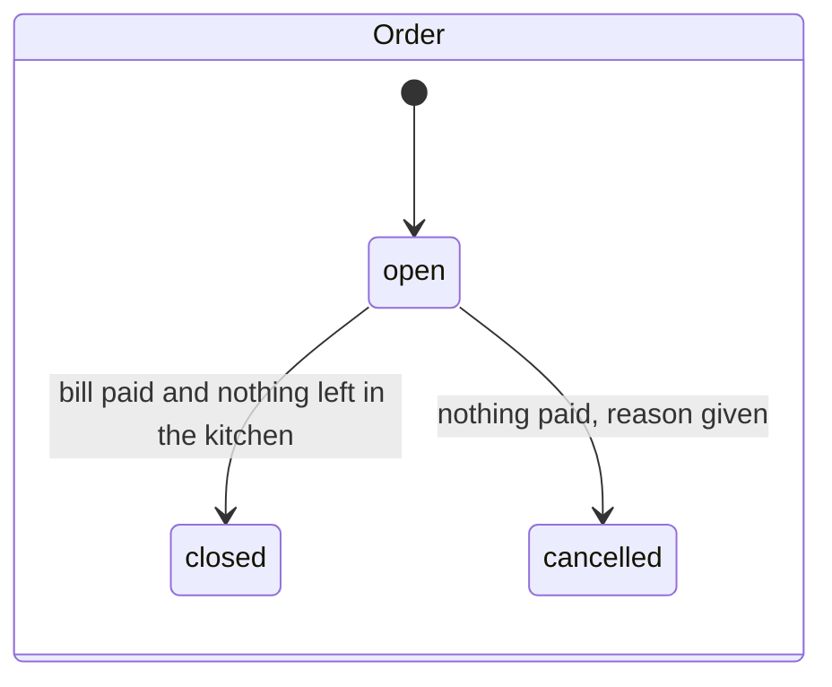
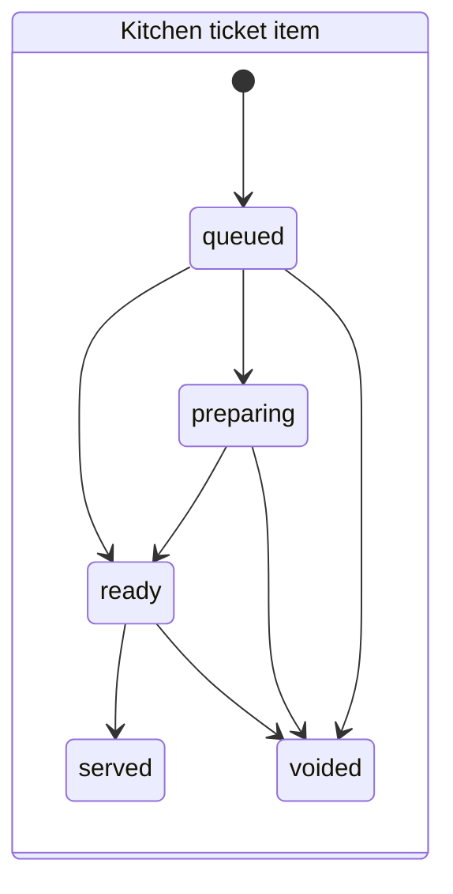
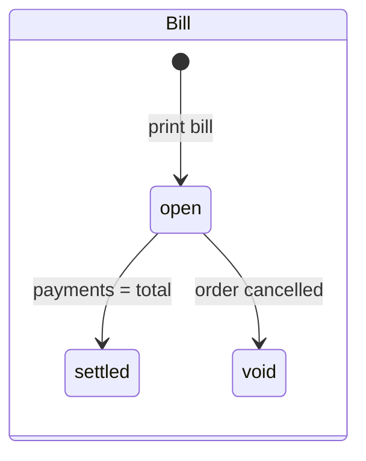

# Order lifecycle and state transitions

Every state change in the restaurant, who may make it, and what happens. All transitions run **on
the hub** in **one SQLite transaction** that also writes the audit entry (when needed), the event
for kitchen screens, and the outbox row for the cloud. Either all of that commits or none of it does.
Models: [`DOMAIN_MODEL.md`](DOMAIN_MODEL.md). Kitchen side: [`KITCHEN_WORKFLOW.md`](KITCHEN_WORKFLOW.md).
Status: **design, awaiting review.**

## 1. The states

There is no single "status" doing every job (brief, Part 9). Five small state machines, plus
values derived from them.

```mermaid
stateDiagram-v2
  direction LR
  state "Order item" as I {
    [*] --> pending: added
    pending --> [*]: removed (never sent)
    pending --> sent: send to kitchen
    sent --> served: all its ticket items served
    sent --> voided: void (reason; waste if cooking started)
  }
```

Payments have no states: each is an append-only record. Table status is derived from orders.

## 2. Transitions

"Event" is what the hub publishes to kitchen screens and the hub UI
([`WEBSOCKET_EVENTS.md`](WEBSOCKET_EVENTS.md)). "Op" is what goes into the outbox for the cloud.
Every request from a screen carries an `Idempotency-Key`; a repeat with the same key returns the
first result and changes nothing.

| # | Transition | Who (capability) | Preconditions | Database changes | Audit | Event | If it fails | Retry |
| --- | --- | --- | --- | --- | --- | --- | --- | --- |
| T1 | Open order | waiter, cashier (`take_orders`) | Dine-in: table active and **free** (unique open order per table) | Insert `Order` (`open`), number from the hub's daily sequence | — | `order.opened` | "Table T12 already has an order" | Same key → same order |
| T2 | Add / change / remove a **pending** item | `take_orders` | Order `open`; item available; modifier choices within min/max | Insert / update / delete `OrderItem` (+ modifiers) with price snapshots | — | `order.updated` | Validation message | Same key → same result |
| T3 | **Send** to kitchen | `send_to_kitchen` | At least one pending item | Pending items → `sent`; one `KitchenTicket` per station with `KitchenTicketItem`s (`queued`); print jobs queued | — | `ticket.created` (per station), `order.updated` | Nothing sent; screen says why | Same key → the same tickets, never a second set |
| T4 | Kitchen starts / finishes an item | kitchen screen of **that station** (`kitchen` role) | Item belongs to the screen's station; `version` matches (compare-and-set) | Ticket item → `preparing` / `ready`, timestamp | — | `ticket.item_changed`; when all items of an order are ready, `order.ready` | 409 "Changed by someone else" + current state | Same key, or state already reached → success, no change |
| T5 | Item served | waiter (`take_orders`) | Ticket item `ready` (or `queued`/`preparing` for items with no kitchen, e.g. bottled water) | Ticket item → `served`; order item → `served` when all its ticket items are | — | `ticket.item_changed`, `order.updated` | 409 with current state | As T4 |
| T6 | **Void** a sent item (whole or part) | `void_sent_item` | Order `open`; voided qty ≤ remaining; reason; bill total after void ≥ amount paid (R6) | Order item `voided_quantity` + reason + `waste` (true if a ticket item was `preparing` or later); matching ticket items → `voided`; a `void` ticket for the station | `restaurant.item_voided` | `ticket.voided`, `order.updated` | Message (e.g. "would make the bill smaller than paid") | Same key → same void |
| T7 | Move table | `move_table` | Order `open`, dine-in; target table free | `Order.table` changes | `restaurant.table_moved` | `table.changed` (both tables) | "T7 is occupied" | Same key |
| T8 | Print bill | `take_payment` | Order `open`, has items | Create or recompute `Bill` (`open`): subtotal, discount, `BillCharge` lines from tax rules valid on the business date; `print_count`+1 | — | `bill.printed`, `table.changed` (→ billing) | — | Re-printing is allowed; it never creates a second bill |
| T9 | Discount | `apply_discount` | Bill `open`; reason; result ≥ amount paid | Bill discount + reason + who; charges recomputed | `restaurant.discount` | `order.updated` | Message | Same key |
| T10 | Take payment | `take_payment` | Bill `open`; amount > 0; non-cash ≤ balance; cash needs an **open shift** (R9); R10 if enabled | Insert `BillPayment` (cash over-tender → `change`; `tip` recorded apart from the bill); if Σ payments = total → bill `settled`; cash prints the receipt, which opens the drawer through the receipt printer | override → `restaurant.payment_override` | `payment.received` | Message | Same key → the same payment, never two |
| T11 | Close order | automatic after T10/T5 | Bill `settled`; every order item `served` or `voided` | Order → `closed`, `closed_at`; outbox op `order_doc` | — | `order.closed`, `table.changed` (→ free) | — (stays open until both hold) | — |
| T12 | Cancel order | `take_orders`; `cancel_order` if anything was sent | Order `open`; **nothing paid**; reason | Order → `cancelled`; open ticket items → `voided` (waste if started); bill → `void`; outbox op `order_doc` | `restaurant.order_cancelled` | `ticket.voided`, `order.cancelled`, `table.changed` | Message | Same key |
| T13 | Sold out / back on | `mark_sold_out` | — | `MenuItem.is_available` (hub copy) + outbox op | `restaurant.sold_out` | `menu.availability` | — | Same key |

Counter service is the same table read in a different order: T1 → T2 → T8 → T10 → T3 → T4 → T5 →
T11. Takeaway is dine-in without a table.

## 3. Concurrency

- The hub is the only writer of restaurant data in the building, and SQLite runs one write
  transaction at a time, so two requests can never interleave halfway.
- Kitchen screens and the hub UI can still act on **stale** information (a cook bumps an item a
  waiter has just voided). Every kitchen action carries the ticket item's `version`; the write
  checks it inside the transaction and refuses with 409 plus the current state if it changed.
  Exactly one action wins (acceptance criterion 5).

## 4. Failure and restart

- A transition either fully commits (data + audit + event + outbox) or leaves nothing behind.
- If the hub stops mid-service, it restarts with every open order exactly as committed. Print jobs
  that were queued but not confirmed are listed on the hub as "not printed" with a one-tap reprint.
- Kitchen screens reconnect by themselves and catch up from their last event number
  ([`OFFLINE_SYNCHRONIZATION.md`](OFFLINE_SYNCHRONIZATION.md#3-kitchen-screens-catching-up)).
